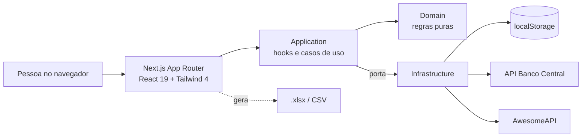
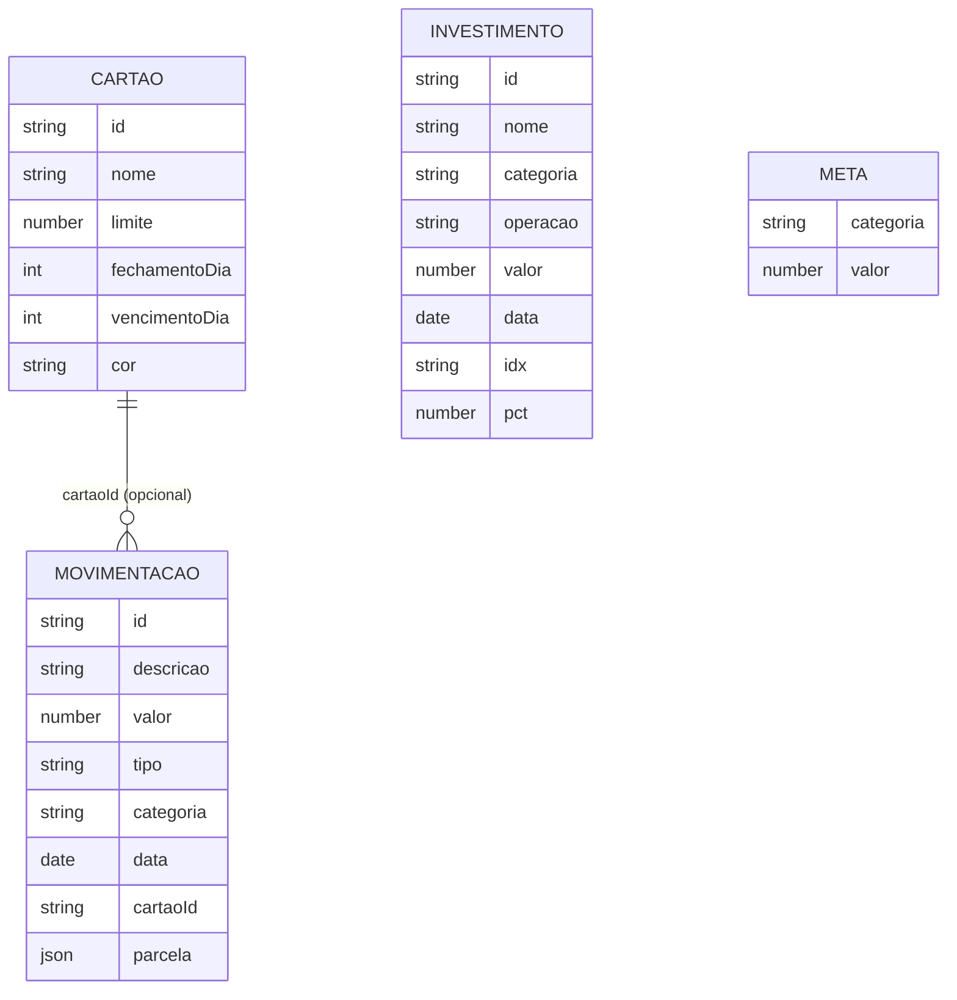
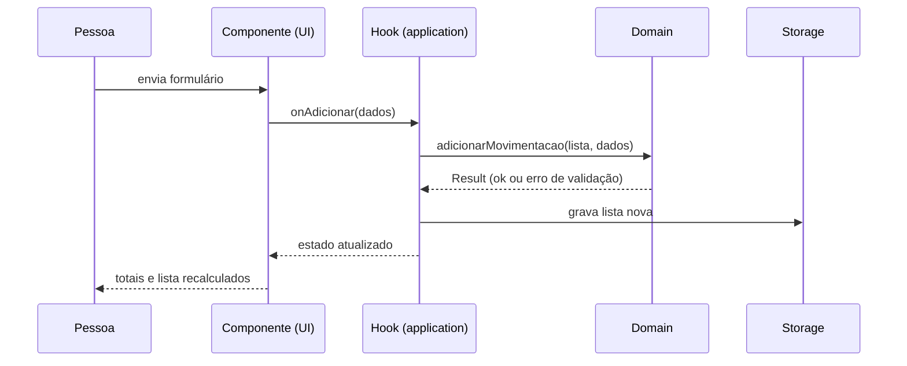

# System Design - FinanceFlow

Visão de arquitetura do sistema. Complementa `feature.spec.md` (estrutura e regras de UI) e `clean-architecture.md` (camadas).
Fonte dos requisitos: `docs/Prd/2_PRD_FinanceFlow.html` (RF, RN e seção 6).

## 1. Contexto e escopo

Aplicação web de controle financeiro pessoal. Fase 1 (MVP): **tudo roda no navegador**, sem servidor próprio e sem login.
Fase 2 (futura): contas e banco de dados na nuvem (Postgres/Supabase).

| | Dentro (MVP) | Fora (por enquanto) |
|---|---|---|
| Dados | Movimentações, cartões, investimentos, metas, tema | Login, banco na nuvem, bancos reais |
| Integrações | Banco Central e AwesomeAPI (somente leitura) | Cotação de ações (exige chave) |
| Saídas | Planilha .xlsx, CSV, copiar | Pagamento de fatura, orçamento por categoria |

## 2. Requisitos arquiteturais

| Atributo | Meta | Como a arquitetura atende |
|---|---|---|
| Correção financeira | Saldo = receitas − despesas, sempre | Regras em funções puras no `domain`, testadas |
| Manutenibilidade | Regra separada da interface | Camadas e regra de dependência |
| Resiliência | App funciona sem internet | Mercado é opcional, com cache de 1 h (RN14) |
| Privacidade | Dados só no navegador | Sem backend; nada sai do dispositivo |
| Acessibilidade | AA, 360 px a 1440 px | Tokens com contraste validado, componentes `ui` acessíveis |
| Desempenho | Abertura em ~1 s | Leitura local, Server Components por padrão |
| Evolução | Trocar localStorage por banco | Portas em `application`, adaptadores em `infrastructure` |

## 3. Visão geral



Linhas pontilhadas são saídas; as demais são dependências de execução.

## 4. Camadas e regra de dependência

```text
app -> components -> application -> domain
                         ^
infrastructure ----------+   (implementa as portas de application)
```

| Camada | Pasta | Responsabilidade | Pode importar |
|---|---|---|---|
| Domínio | `src/domain` | Regras de negócio puras, tipos, `Result` | nada fora de `domain` |
| Aplicação | `src/application` | Casos de uso, portas, hooks de estado | `domain` |
| Infraestrutura | `src/infrastructure` | localStorage, clientes HTTP | `domain`, `application/ports` |
| Apresentação | `src/components` | UI (ui, layout, sections, data) | `application`, `domain` (puro), `content`, `lib` |
| Rotas | `src/app` | Composição, layout, metadata | `components` |
| Conteúdo | `src/content` | Todo texto visível | nada |
| Utilitários | `src/lib` | Formatação, `cn` | nada de negócio |

Exceção documentada: hooks em `application/hooks` usam `infrastructure/storage` direto (`usePersistedState`).

## 5. Mapa de módulos

### Domain (`src/domain`)

| Módulo | Funções principais | Regras |
|---|---|---|
| `shared/` | `Result`, dinheiro (centavos), datas, ids | Valor arredondado só aqui |
| `account/operations` | adicionar, excluir, restaurar movimentação; aporte e resgate | RN02, RN04, RN07, RN08 |
| `account/transactions` | filtrar por tipo, categoria, pagamento, mês; ordenar | RF06, RF11, RF19 |
| `account/summary` | totais de receitas, despesas, saldo | RN01, RN12 |
| `account/cards` | fatura aberta, disponível, vencimento, remover cartão | RN05, RN06 |
| `account/installments` | dividir compra em N parcelas | RN12 |
| `account/portfolio` | total investido, por categoria, meta | RN08, RN09 |
| `account/monthly` | agrupar por mês, sobra, saldo anterior | RN11 |
| `account/spreadsheet` | grade categorias × 12 meses | RN10 |
| `account/parse` | validar dados vindos do storage | dado externo não confiável |
| `market/yield` | rendimento estimado (juros compostos) | RN13 |
| `market/chart` | séries dos gráficos | RF21 |

### Application (`src/application`)

| Item | Papel |
|---|---|
| `hooks/useTransactions`, `useCards`, `useInvestments`, `useGoals`, `useTheme` | Estado (`useState`) + persistência; chamam funções do domínio |
| `hooks/usePersistedState` | Lê/grava no storage com validação |
| `ports/MarketRepository` | Contrato para buscar indicadores de mercado |
| `market/` | Caso de uso: buscar, cachear 1 h, degradar em falha |

### Infrastructure (`src/infrastructure`)

| Item | Papel |
|---|---|
| `storage/` | localStorage reativo, chaves versionadas |
| `market/` | Adaptadores do Banco Central e da AwesomeAPI |
| `composition.ts` | Liga porta → adaptador |

### Components (`src/components`)

| Pasta | Conteúdo |
|---|---|
| `ui/` | Botão, campo, controle segmentado, etiqueta, aviso, demonstrativo, cartão de crédito. Sem texto de negócio |
| `layout/` | Cabeçalho, menu lateral, barra inferior, rodapé |
| `sections/<seção>/` | Painel, Lançamentos, Planilha do ano, Cartões, Investimentos |
| `data/` | Provedores de dados que ligam hooks ao resto da UI |

## 6. Modelo de dados



Investimentos **não se ligam** a movimentações (RN07). A planilha do ano **não tem dados próprios** (RN10).

| Chave localStorage | Conteúdo |
|---|---|
| `financeflow:movimentacoes` | lista de movimentações |
| `financeflow:cartoes` | cartões |
| `financeflow:investimentos` | aportes e resgates |
| `financeflow:metas` | metas por categoria |
| `financeflow:mercado:v1` | cache de mercado (1 h) |
| `financeflow:tema` | `light` ou `dark` |

Modelo relacional da fase 2: PRD seção 5 (tabelas `cartoes`, `movimentacoes`, `investimentos`, `metas_investimento`, com RLS por usuário).

## 7. Fluxo de dados



Regra de ouro: **dados descem por props, ações sobem por eventos**. Totais são sempre derivados, nunca guardados.

## 8. Renderização e estado

- Server Component por padrão; `"use client"` só em componentes com estado, evento ou efeito, isolados e pequenos.
- Leitura do localStorage só no cliente (evita erro de hidratação). Tema aplicado antes da hidratação para não piscar.
- Navegação por rotas do App Router: `/` (Painel), `/lancamentos`, `/planilha`, `/cartoes`, `/investimentos`.

## 9. Integrações externas

| Fonte | Dados | Tratamento de falha |
|---|---|---|
| Banco Central | Selic, CDI, IPCA | Último valor guardado ou aviso (RN14) |
| AwesomeAPI | Dólar, euro, bitcoin | Idem |

Resposta externa é validada na borda antes de entrar no sistema. Cache de 1 hora e botão Atualizar.

## 10. Qualidade transversal

- **Segurança e privacidade:** sem backend, sem credenciais, sem dado pessoal enviado. Entrada do usuário e do storage validada no domínio.
- **Acessibilidade:** contraste AA, foco visível, alvos de 44 a 48 px, cor nunca é o único sinal.
- **Testes:** Vitest nas funções de domínio (RN01 a RN15); verificação `lint`, `typecheck`, `test`, `build` em todo PR.
- **Observabilidade (fase 2):** não se aplica ao MVP.

## 11. Decisões e pendências

| # | Tema | Situação |
|---|---|---|
| D1 | Stack: Next 16, React 19, TS, Tailwind 4 | Decidido (feature.spec.md) |
| D2 | Persistência em localStorage, uma chave por lista | Decidido (PRD seção 5) |
| D3 | Planilha calculada, não salva | Decidido (RN10) |
| D4 | Investimento fora dos totais | Decidido (RN07) |
| P1 | Fonte de mercado: PRD diz Banco Central + AwesomeAPI; `clean-architecture.md` cita CoinGecko | **Pendente**, equipe decide |
| P2 | Saldo do topo desconta o investido? | **Pendente**, sugestão: não descontar |
| P3 | PRD cita CSS Modules e `page.js`; spec manda Tailwind e TypeScript | Adotado o spec; ajustar o PRD |
| P4 | Biblioteca de gráficos e de .xlsx | **Pendente**, decidir nos cards 0028 e 0039 |

## 12. Evolução (fase 2)

Trocar `infrastructure/storage` por um repositório remoto (Supabase) implementando as mesmas portas, sem alterar `domain`. Login, sincronização entre aparelhos e fila offline.

## 13. Rastreabilidade com o Trello

| Épico | Camadas tocadas | Módulos |
|---|---|---|
| FF-0001 Fundação | domain, infra, config | `shared`, estrutura |
| FF-0002 Design system | ui, layout | `components/ui`, `components/layout`, tokens |
| FF-0003 Lançamentos | domain, application, sections | `operations`, `transactions`, `summary` |
| FF-0004 Painel, mês, planilha | domain, sections | `monthly`, `spreadsheet`, `chart` |
| FF-0005 Cartões e parcelas | domain, sections | `cards`, `installments` |
| FF-0006 Investimentos e mercado | domain, infra, sections | `portfolio`, `yield`, `infrastructure/market` |
| FF-0007 Persistência, exportação, tema | application, infra | `parse`, `usePersistedState`, exportadores |
| FF-0008 Qualidade e entrega | todas | testes, CI, deploy |
